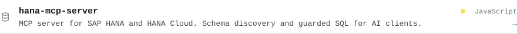
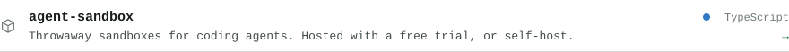
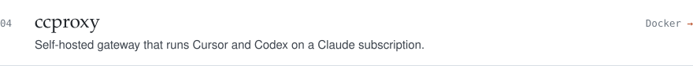
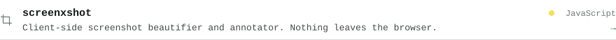
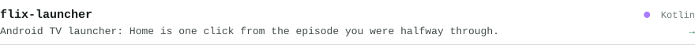
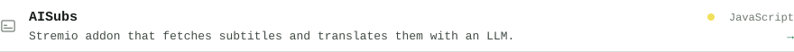
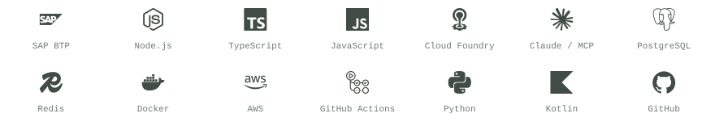

<!-- Hallmark · macrostructure: Map/Diagram · theme: Terminal · tone: technical · anchor hue: green 150 · nav: none · footer: Ft2 -->
<picture><source media="(prefers-color-scheme: dark)" srcset="assets/open-dark.svg"></picture>

<picture><source media="(prefers-color-scheme: dark)" srcset="assets/diagram-dark.svg"></picture>

 

<picture><source media="(prefers-color-scheme: dark)" srcset="assets/head-sap-dark.svg"></picture>
<a href="https://github.com/HatriGt/hana-mcp-server"><picture><source media="(prefers-color-scheme: dark)" srcset="assets/row-hana-mcp-server-dark.svg"></picture></a>
<a href="https://github.com/HatriGt/sap-cap-debugger"><picture><source media="(prefers-color-scheme: dark)" srcset="assets/row-sap-cap-debugger-dark.svg"></picture></a>

<picture><source media="(prefers-color-scheme: dark)" srcset="assets/head-tools-dark.svg"></picture>
<a href="https://github.com/HatriGt/agent-sandbox"><picture><source media="(prefers-color-scheme: dark)" srcset="assets/row-agent-sandbox-dark.svg"></picture></a>
<a href="https://github.com/HatriGt/ccproxy"><picture><source media="(prefers-color-scheme: dark)" srcset="assets/row-ccproxy-dark.svg"></picture></a>
<a href="https://github.com/HatriGt/screenxshot"><picture><source media="(prefers-color-scheme: dark)" srcset="assets/row-screenxshot-dark.svg"></picture></a>

<picture><source media="(prefers-color-scheme: dark)" srcset="assets/head-side-dark.svg"></picture>
<a href="https://github.com/HatriGt/flix-launcher"><picture><source media="(prefers-color-scheme: dark)" srcset="assets/row-flix-launcher-dark.svg"></picture></a>
<a href="https://github.com/HatriGt/AISubs"><picture><source media="(prefers-color-scheme: dark)" srcset="assets/row-AISubs-dark.svg"></picture></a>

Everything else: <a href="https://github.com/HatriGt?tab=repositories">github.com/HatriGt?tab=repositories</a>

 

<picture><source media="(prefers-color-scheme: dark)" srcset="assets/head-stack-dark.svg"></picture>
<picture><source media="(prefers-color-scheme: dark)" srcset="assets/wall-dark.svg"></picture>

 

<a href="https://linkedin.com/in/ajeethkumar95"><picture><source media="(prefers-color-scheme: dark)" srcset="assets/soc-linkedin-dark.svg"></picture></a>&nbsp;&nbsp; <a href="https://x.com/hatrigt"><picture><source media="(prefers-color-scheme: dark)" srcset="assets/soc-x-dark.svg"></picture></a>&nbsp;&nbsp; <a href="https://instagram.com/hatrigt"><picture><source media="(prefers-color-scheme: dark)" srcset="assets/soc-instagram-dark.svg"></picture></a>
