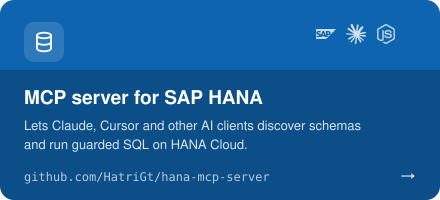
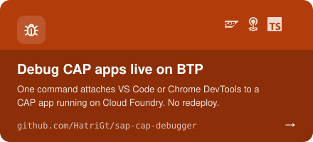
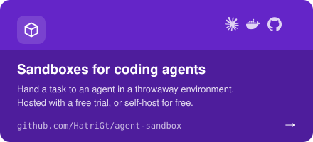
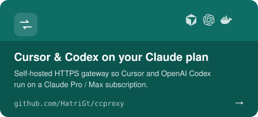
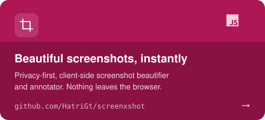
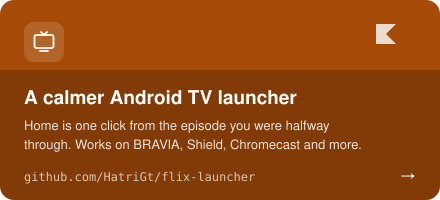

### About me

- Building on **SAP BTP** every day: CAP services, HANA Cloud, Cloud Foundry
- Making **MCP servers and agent tooling** so AI assistants can work safely with enterprise systems
- Shipping developer tools that remove friction: debuggers, proxies, sandboxes
- Two packages on npm: [hana-mcp-server](https://www.npmjs.com/package/hana-mcp-server) and [sap-cap-debugger](https://www.npmjs.com/package/sap-cap-debugger)
- Off the clock: photography and Lightroom

### Featured projects

 &nbsp;&nbsp;&nbsp;
 

More: [AISubs](https://github.com/HatriGt/AISubs) · [awesome-simple-skills](https://github.com/HatriGt/awesome-simple-skills) · [reddit-reach-server](https://github.com/HatriGt/reddit-reach-server) · [all repositories →](https://github.com/HatriGt?tab=repositories)

### Tech stack

**Languages & runtime** 

**Backend & data** 

**Cloud & DevOps** 

**SAP & AI** 
    

**Design** 

### GitHub activity

