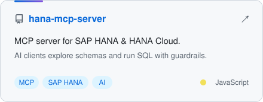
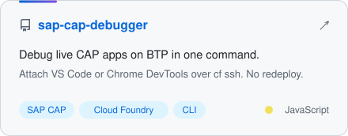
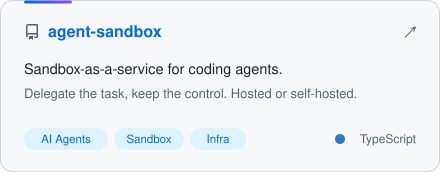
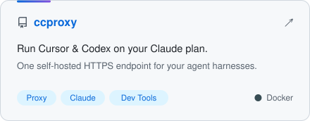
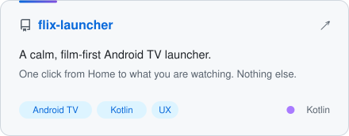
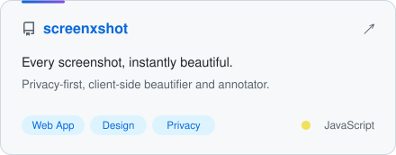

<!-- Designed for both light & dark GitHub themes. Source assets live in /assets. -->

<picture><source media="(prefers-color-scheme: dark)" srcset="assets/header-dark.svg"></picture>

 

&nbsp;
&nbsp;

 

<picture><source media="(prefers-color-scheme: dark)" srcset="assets/title-about-dark.svg"></picture>

I build **AI agent tooling** and **developer tools** for **SAP BTP**: MCP servers that let LLMs safely work with SAP HANA, one-command debuggers for CAP apps on Cloud Foundry, and sandboxes and proxies that make coding agents practical day to day.

| Now | Stack | Off-hours |
|:--|:--|:--|
| MCP servers and agent infrastructure | CAP · HANA Cloud · Cloud Foundry · Node.js | Photography & design: Lightroom, Photoshop, After Effects |

 

<picture><source media="(prefers-color-scheme: dark)" srcset="assets/title-projects-dark.svg"></picture>

<a href="https://github.com/HatriGt/hana-mcp-server"><picture><source media="(prefers-color-scheme: dark)" srcset="assets/proj-hana-mcp-server-dark.svg"></picture></a>
<a href="https://github.com/HatriGt/sap-cap-debugger"><picture><source media="(prefers-color-scheme: dark)" srcset="assets/proj-sap-cap-debugger-dark.svg"></picture></a>

<a href="https://github.com/HatriGt/agent-sandbox"><picture><source media="(prefers-color-scheme: dark)" srcset="assets/proj-agent-sandbox-dark.svg"></picture></a>
<a href="https://github.com/HatriGt/ccproxy"><picture><source media="(prefers-color-scheme: dark)" srcset="assets/proj-ccproxy-dark.svg"></picture></a>

<a href="https://github.com/HatriGt/flix-launcher"><picture><source media="(prefers-color-scheme: dark)" srcset="assets/proj-flix-launcher-dark.svg"></picture></a>
<a href="https://github.com/HatriGt/screenxshot"><picture><source media="(prefers-color-scheme: dark)" srcset="assets/proj-screenxshot-dark.svg"></picture></a>

Also: <a href="https://github.com/HatriGt/AISubs">AISubs</a> · <a href="https://github.com/HatriGt/awesome-simple-skills">awesome-simple-skills</a> · <a href="https://github.com/HatriGt/reddit-reach-server">reddit-reach-server</a> · <a href="https://github.com/HatriGt?tab=repositories">all repositories →</a>

 

<picture><source media="(prefers-color-scheme: dark)" srcset="assets/title-stack-dark.svg"></picture>

    
    
  
  
  
  
  

 

<picture><source media="(prefers-color-scheme: dark)" srcset="assets/title-stats-dark.svg"></picture>

  <picture>
    <source media="(prefers-color-scheme: dark)" srcset="https://github-readme-stats.vercel.app/api?username=hatrigt&show_icons=true&include_all_commits=true&count_private=true&hide_border=true&hide_title=true&bg_color=161b22&text_color=e6edf3&icon_color=58a6ff&title_color=58a6ff&border_radius=12">
    
  </picture>
  <picture>
    <source media="(prefers-color-scheme: dark)" srcset="https://github-readme-stats.vercel.app/api/top-langs/?username=hatrigt&layout=compact&langs_count=6&hide_border=true&hide_title=true&bg_color=161b22&text_color=e6edf3&border_radius=12">
    
  </picture>

 

Open to collaborating on SAP + AI tooling. <a href="https://linkedin.com/in/ajeethkumar95">Say hi on LinkedIn</a>.

