<!-- Cinematic profile. Assets are generated by scripts/generate_assets.py -->

 

<picture><source media="(prefers-color-scheme: dark)" srcset="assets/section-work-dark.svg"></picture>

  
  

More: <a href="https://github.com/HatriGt/AISubs">AISubs</a> · <a href="https://github.com/HatriGt/awesome-simple-skills">awesome-simple-skills</a> · <a href="https://github.com/HatriGt/reddit-reach-server">reddit-reach-server</a> · <a href="https://github.com/HatriGt?tab=repositories">all repositories →</a>

 

<picture><source media="(prefers-color-scheme: dark)" srcset="assets/section-stack-dark.svg"></picture>

 

<picture><source media="(prefers-color-scheme: dark)" srcset="assets/section-stats-dark.svg"></picture>

 

<picture><source media="(prefers-color-scheme: dark)" srcset="assets/section-about-dark.svg"></picture>

Built with hand-made SVG · no templates harmed

